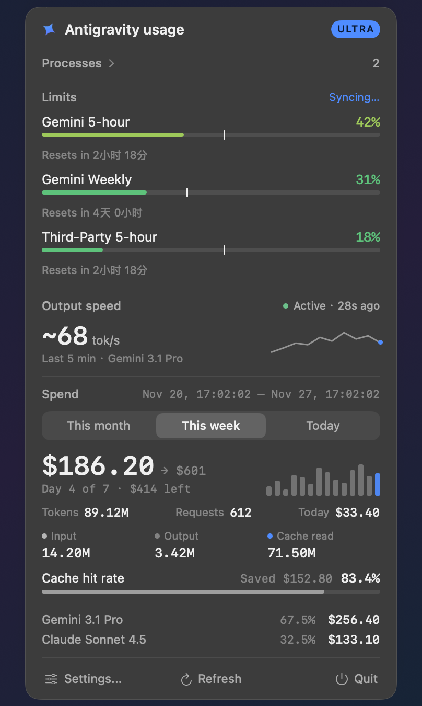
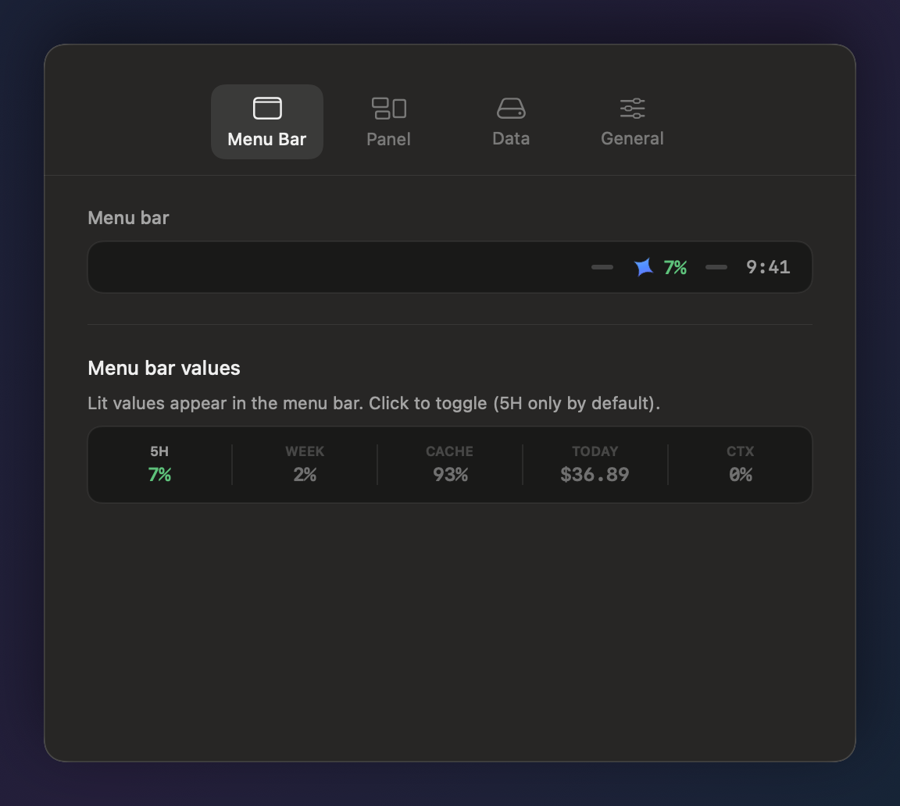

<div align="center">



# Antigravity Usage Monitor

**Your exact Antigravity limits and local token spend, right in the menu bar.**

Official 5-hour and weekly quota from the `agy` CLI, paired with local transcript analytics<br>
for cache hit rate, model split, and API-equivalent spend. Native Swift 6, zero dependencies, zero packet capture.

[](https://github.com/panmingxuan/antigravity-usage-monitor/releases/latest)
[](#install)
[](Package.swift)
[](LICENSE)

[**Download**](https://github.com/panmingxuan/antigravity-usage-monitor/releases/latest) · [中文说明](README.zh-CN.md)

</div>

<br>

## Highlights

<table>
<tr>
<td width="50%" valign="top">

**Official limits, never guessed**<br>
Reads official 5-hour and weekly buckets (`gemini-5h`, `gemini-weekly`, `3p-5h`, `3p-weekly`) through the official `agy` CLI `statusLine` contract — no packet capture, no private APIs, no Keychain access.

</td>
<td width="50%" valign="top">

**Only what you want in the menu bar**<br>
Shows the 5-hour usage percentage by default alongside a tilted four-point star icon. Optionally add Weekly, Cache Hit Rate, Today's Spend, or Context, and configure every panel section as Detailed, Simple, or Hidden.

</td>
</tr>
<tr>
<td valign="top">

**See a limit coming with Safe Line**<br>
Each quota bar includes a white safe-pace tick showing how much you can spend by now and still last until reset. Usage past the pace line turns warm/red, and expired windows auto-zero locally.

</td>
<td valign="top">

**Silent background sync**<br>
Syncs fresh official quota silently via an ephemeral `agy --settings` session in a background PTY — without keeping Terminal open, spending LLM tokens, or modifying your `~/.gemini/antigravity/settings.json`.

</td>
</tr>
<tr>
<td valign="top">

**Spend, cache savings & 14-day trend**<br>
Parses local `transcript.jsonl` incrementally to compute API-equivalent spend (USD / CNY), cache hit rate, cache savings, per-model breakdown, projected full-quota cost, and a 14-day bar chart.

</td>
<td valign="top">

**Native, fast & zero-dependency**<br>
Built with pure Swift 6 + SwiftUI + AppKit for macOS 15+ (Apple Silicon). Zero third-party Swift packages, translucent dark frosted glass panel, hover tooltips, and optional local alerts.

</td>
</tr>
</table>

## Screenshots

<table>
<tr>
<td width="44%" align="center" valign="top">
<br>
<sub><b>The panel</b> · official limits with safe lines, output speed, spend & 14-day trend</sub>
</td>
<td width="56%" align="center" valign="top">
<br>
<sub><b>Settings › Menu Bar</b> · live preview and one-click column toggles</sub>
</td>
</tr>
</table>

## Install

### Option 1: GitHub Releases (`.dmg` or `.zip`)

Download the latest `AntigravityUsageMonitor-*-macOS-arm64.dmg` (or `.zip`) from [GitHub Releases](https://github.com/panmingxuan/antigravity-usage-monitor/releases/latest), drag **`Antigravity Usage Monitor.app`** into `/Applications`, and launch.

> **First-launch note (self-signed open-source build):** This app is ad-hoc signed rather than notarized with a paid Apple Developer certificate. If macOS Gatekeeper blocks the first launch, run once:
>
> ```bash
> xattr -dr com.apple.quarantine "/Applications/Antigravity Usage Monitor.app"
> ```

### Option 2: Homebrew Cask

```bash
brew tap panmingxuan/antigravity-usage-monitor https://github.com/panmingxuan/antigravity-usage-monitor
brew install --cask antigravity-usage-monitor
```

### Option 3: Build from Source

Requires macOS 15+ and Swift 6 (Xcode 16+ or Apple Command Line Tools):

```bash
git clone https://github.com/panmingxuan/antigravity-usage-monitor.git
cd antigravity-usage-monitor
make test
make app
make dmg # optional: generates dist/AntigravityUsageMonitor-*-macOS-arm64.dmg
```

## Privacy & Data Sources

This project strictly separates official quota from local analytics and never touches credentials or private endpoints:

| Data | Source | Scope |
| :--- | :--- | :--- |
| **Official Quota & Plan** | Official `agy` CLI `statusLine` JSON | 5-hour / weekly limits, reset timestamps, plan tier, account email |
| **Local Usage Analytics** | `~/.gemini/antigravity/brain/**/transcript.jsonl` | Input / cache-read / output tokens, cache hit rate, model split, API-equivalent cost |
| **Network / Credentials** | **None** | Zero packet capture, zero undocumented HTTP endpoints, zero Keychain reads |

## Fork & Adapt for Other AI Agents

Want a similar native macOS menu bar monitor for another AI coding agent (such as **Codex**, **Cursor**, **OpenCode**, **Gemini CLI**, or an internal agent)? **Feel free to fork, copy, or reuse any part of this codebase!**

The repository is intentionally split into two clean layers:
- `Sources/UsageCore/` — Data models, incremental JSONL transcript parser, aggregator, quota evaluator, pricing catalog, and CLI syncer. Swap or adapt the parser/syncer to point at your target agent's local logs and quota source.
- `Sources/AntigravityUsageMonitor/` — Pure SwiftUI + AppKit translucent floating panel, menu bar renderer, tooltips, and settings window. Ready to reuse with minimal changes.

## Credits & Acknowledgements

This project is deeply inspired by [**claude-usage-monitor**](https://github.com/kittors/claude-usage-monitor) by [@kittors](https://github.com/kittors). The menu bar density, safe-pace line concept, frosted glass panel aesthetics, and attention to native macOS craft all draw directly from its design. Thank you for open-sourcing such a thoughtful tool!

## License

[MIT](LICENSE)
