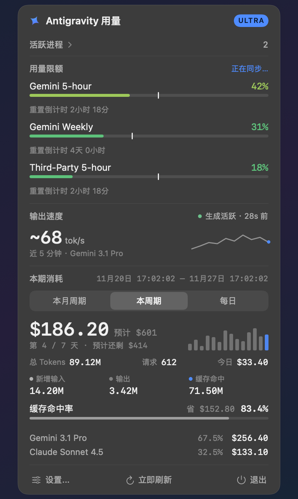
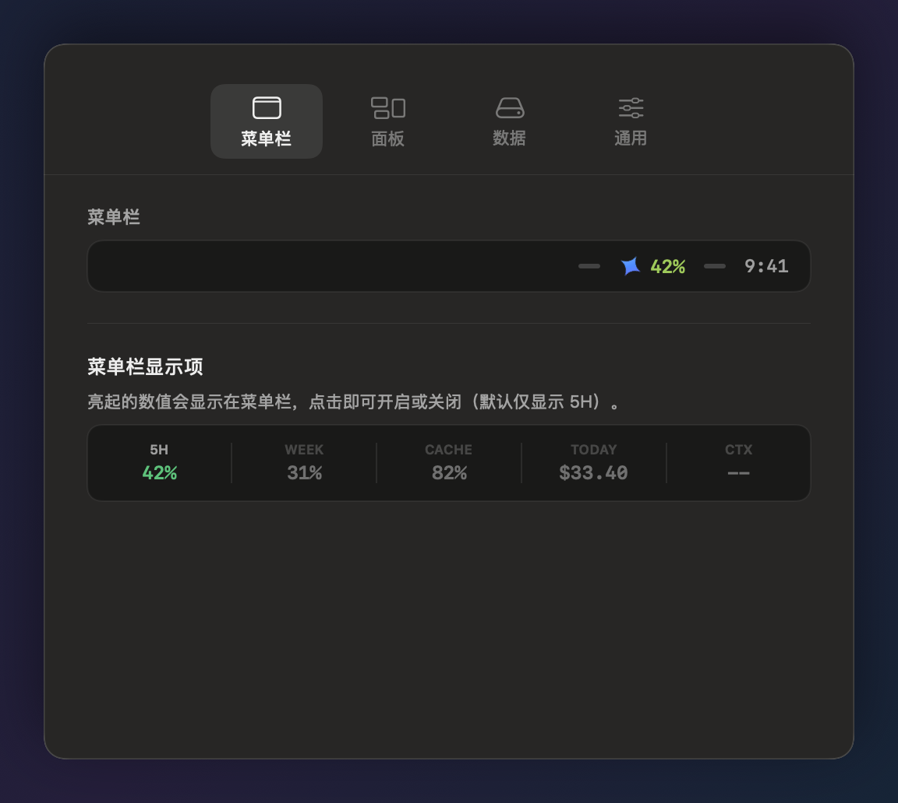

<div align="center">


# Antigravity Usage Monitor

**把 Antigravity 的官方配额与本地 Token 消耗，直接放进 macOS 菜单栏。**

通过官方 `agy` CLI 获取 5 小时 / 每周配额与安全线，结合本地对话日志统计缓存命中率、模型分布与 API 等效费用。<br>
纯 Swift 6 原生实现，零第三方依赖，零抓包。

[](https://github.com/panmingxuan/antigravity-usage-monitor/releases/latest)
[](#安装方式)
[](Package.swift)
[](LICENSE)

[**下载最新版**](https://github.com/cassianpan/antigravity-usage-monitor/releases/latest) · [English README](README.md) · [更新日志](CHANGELOG.zh-CN.md)

</div>

<br>

## 核心特性

<table>
<tr>
<td width="50%" valign="top">

**官方配额，不做猜测**<br>
通过官方 `agy` CLI 的 `statusLine` 契约读取 5 小时与每周额度（`gemini-5h`、`gemini-weekly`、`3p-5h`、`3p-weekly`），绝不抓包、不调未公开接口、不读系统钥匙串。

</td>
<td width="50%" valign="top">

**菜单栏与面板按需定制**<br>
菜单栏默认仅显示倾斜四角星图标与 5 小时用量百分比；可在设置中一键开关周限额、缓存命中率、今日消费或上下文占比，面板各模块均支持「详细 / 简洁 / 隐藏」。

</td>
</tr>
<tr>
<td valign="top">

**安全线提前预警节奏**<br>
每条配额进度条都带有白色安全线刻度，直观显示按当前时间进度消耗到哪里刚好撑到重置；超速即高亮预警，超过重置时间后本地自动归零。

</td>
<td valign="top">

**后台静默同步**<br>
通过后台 PTY 以临时 `--settings` 会话静默拉取最新官方配额——无需常驻打开终端、不消耗任何模型 Token，也不会篡改你的 `~/.gemini/antigravity/settings.json`。

</td>
</tr>
<tr>
<td valign="top">

**消耗、缓存省费与 14 天趋势**<br>
增量解析本地 `transcript.jsonl`，统计本期/本周/今日的 API 等效费用（支持 USD / CNY 汇率换算）、缓存命中率、缓存节省金额、按模型占比、预计用满消耗与 14 天趋势柱图。

</td>
<td valign="top">

**原生轻量，零第三方依赖**<br>
纯 Swift 6 + SwiftUI + AppKit 打造（macOS 15+ Apple Silicon），深色半透明毛玻璃浮层面板、悬停提示气泡、可选估算输出速度与本地提醒通知。

</td>
</tr>
</table>

## 界面预览

<table>
<tr>
<td width="44%" align="center" valign="top">
<br>
<sub><b>主面板</b> · 官方配额与安全线、输出速度、消耗统计与 14 天趋势</sub>
</td>
<td width="56%" align="center" valign="top">
<br>
<sub><b>设置 › 菜单栏</b> · 实时菜单栏预览与一键点击开关列</sub>
</td>
</tr>
</table>

## 安装方式

### 方式一：Homebrew Cask（推荐，装完直接打开免弹窗）

```bash
brew tap cassianpan/antigravity-usage-monitor https://github.com/cassianpan/antigravity-usage-monitor
brew install --cask antigravity-usage-monitor
```

安装脚本会自动清除 macOS 的 `com.apple.quarantine` 隔离标记，安装完成后可直接打开使用，无需手动放行。

### 方式二：GitHub Releases（`.dmg` 或 `.zip`）

前往 [GitHub Releases](https://github.com/cassianpan/antigravity-usage-monitor/releases/latest) 下载最新的 `AntigravityUsageMonitor-*-macOS-arm64.dmg`（或 `.zip`），将 **`Antigravity Usage Monitor.app`** 拖入 `/Applications` 即可使用。

### 方式三：从源码构建

需要 macOS 15+ 及 Swift 6（Xcode 16+ 或 Apple Command Line Tools）：

```bash
git clone https://github.com/cassianpan/antigravity-usage-monitor.git
cd antigravity-usage-monitor
make test
make app
make dmg # 可选：在 dist/ 目录生成 .dmg 安装镜像
```

### 自签说明与首次打开放行

本项目为开源 **ad-hoc 自签名**打包（`codesign --force --deep --sign -`），未经过付费 Apple Developer ID 公证。因此通过浏览器下载 `.dmg` / `.zip` 首次打开时，macOS Gatekeeper 可能会弹出“Apple 无法验证……”。

任选以下一种方式放行即可：

1. **系统设置放行（图形界面）**：在弹窗中点击「完成」→ 打开「系统设置 › 隐私与安全性」→ 滑到底部点击「仍要打开」。
2. **终端一行命令放行**：
   ```bash
   xattr -dr com.apple.quarantine "/Applications/Antigravity Usage Monitor.app"
   ```

如需在本地重新自签（或使用你自己钥匙串里的代码签名证书重签）：

```bash
# 本地 ad-hoc 自签
codesign --force --deep --sign - "/Applications/Antigravity Usage Monitor.app"

# 或使用本机钥匙串中的自建/个人证书签名
codesign --force --deep --sign "<你的证书名称>" "/Applications/Antigravity Usage Monitor.app"
```

## 隐私与数据来源说明

本项目严格区分官方配额数据与本地统计数据，不触碰任何登录凭据或未公开接口：

| 数据类别 | 来源 | 说明 |
| :--- | :--- | :--- |
| **官方配额与订阅** | 官方 `agy` CLI `statusLine` JSON | 5 小时 / 每周额度、重置时间、订阅档位、账号邮箱 |
| **本地消耗统计** | `~/.gemini/antigravity/brain/**/transcript.jsonl` | 新增输入 / 缓存命中 / 输出 Token、缓存命中率、模型分布、API 等效估算费用 |
| **抓包 / 凭据读取** | **无** | 零抓包、零私密 HTTP 接口、零 Keychain 读写 |

## 参考 / Fork 适配其他 AI Agent

如果你想为其他 AI 编程工具（如 **Codex**、**Cursor**、**OpenCode**、**Gemini CLI** 或自研 Agent）做一个同款原生 macOS 菜单栏用量监控，**非常欢迎直接 Fork、参考或复制本仓库的代码！**

项目结构特意保持了清晰的两层解耦：
- `Sources/UsageCore/`：核心数据模型、增量 JSONL 日志解析器、聚合器、配额评估器、价格目录与 CLI 同步器——只需替换或扩展解析器与配额同步器，即可快速接入任意 Agent 的本地日志和额度源。
- `Sources/AntigravityUsageMonitor/`：纯 SwiftUI + AppKit 打造的毛玻璃浮层面板、菜单栏渲染器、悬停提示与设置窗口，几乎可以直接复用。

## 致谢

本项目深受 [@kittors](https://github.com/kittors) 开源的 [**claude-usage-monitor**](https://github.com/kittors/claude-usage-monitor) 启发。无论是菜单栏信息密度、配额安全线设计、深色毛玻璃面板质感，还是对 macOS 原生体验的打磨，都参考并致敬了原项目的优秀理念。非常感谢原作者的开源分享！

## 开源协议

[MIT](LICENSE)
